# Shehan Nadeesha — Portfolio (solid red / white)

A job-ready, mobile-first portfolio: **solid red + white** theme with **zero
gradients**, scroll-driven morphs, an ASCII-tile portrait, a 3D wooden
achievement cabinet, a 30-second morph player and a live code workbench — plus
an inline icon system with fully self-hosted assets. (The insight deck was
removed at the owner's request; nothing on the page depends on it any more.)

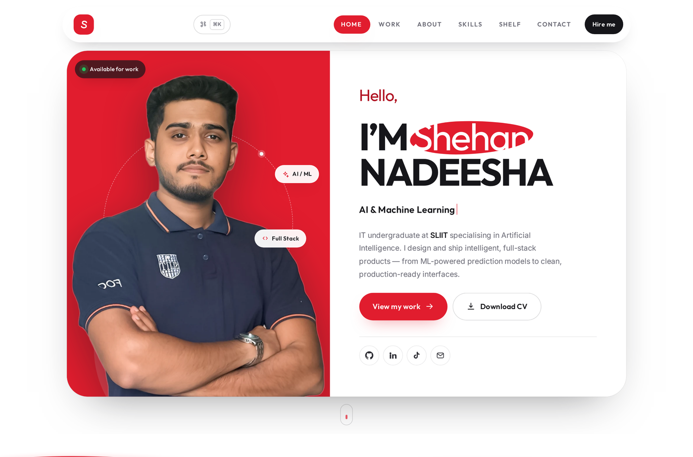

## Latest iteration

| Request | What was done |
|---|---|
| **Solid red + white, no gradients** | Every `linear-gradient` / `radial-gradient` / `conic-gradient` was removed — verified by auditing computed styles in the browser (0 elements with a gradient background). Palette is now `#e11d2e` red, `#16161a` ink, `#ffffff` white, one flat tint `#fde9eb`. Highlights that used gradients became solid fills; glows were replaced with solid accents or dropped. |
| **Advanced, hard-to-find interactions** | Nine interaction systems plus: command palette, interactive terminal, torch reveal, scroll-scrubbed statement, magnetic pull, spotlight cards, 3D tilt, stencil wordmark, rotating status ring. The custom cursor overlay was retired — the native OS pointer is used everywhere. |

## The signature layer — six more systems

| Feature | What happens | How to try it |
|---|---|---|
| **30-second morph player** | A full-screen kinetic recap of the build: 112 tiles resolve through six chapters (2024 → Now) — scatter, split, rise, wave, web, then a collapse toward "Available". Each chapter drives its own tile geometry from the playhead. | Press **`P`** |
| **Trace overlay** | Labels the live DOM in place — outlines plus `element · width×height` tags over the nav, portrait, hero copy, cards — while auditing the document for gradient backgrounds. Includes an honest *"0 CSS gradients"* readout. | **`Shift+T`** |
| **Live workbench** | A three-file editor (HTML / CSS / JS) with a hand-written single-pass syntax highlighter, live search with hit counts, and a sandboxed iframe that actually **runs** the code — press *Plan today's routes* and the forecast script executes. | **`Shift+W`** |
| **Achievement cabinet** | A **3D wooden shelf** that grows with me — right now it holds the **YouTube Play Button** and my **AI/ML Stage 1 certificate from SLIIT** (nothing invented). The section copy is written so new pieces slot in without a rewrite. The case is CSS 3D — flat wood grain, an inner panel, a bevelled frame and a spotlight cone — and each piece sits on its own plinth. Hover lifts and turns the piece and reveals its detail line; **drag the shelf** or use ←/→ to re-angle the whole cabinet; scroll tilts it as it crosses the viewport. No WebGL. **Click a piece** (or press Enter on it) and the real render opens on a full-screen **3D stage**: a **solid-backed plate** sized to the object — **3:4 portrait for the play button, 4:3 landscape for the certificate** — that eases toward the pointer, drags to turn, nudges with ←/→, and floats over the same image blown up and **blurred** as the backdrop. Esc or ✕ closes it and puts focus back on the plinth. | Nav **SHELF**, **`G` `B`**, or scroll past the portrait |
| **Coming-soon card** | One unnamed card: animated radar placeholder art (orbit, sweep, breathing blob) over a flat line grid, a skeleton readout with a twelve-bar loading strip, then redacted project name, stage / ETA / name rows and an honest quote. No status dots anywhere — they read as stray cursor points. | Scroll the **Work** grid |
| **The portrait — 2,440 ASCII tiles** | Your headshot is not an image here: it is **2,440 characters** sampled from the photo's own luminance (40 × 61 on desktop, a coarser 26 × 40 set that swaps in under 640 px so the glyphs stay readable). Scroll and every tile flies in from depth, staggered, and locks into a grid that *is* the portrait — scan line, corner brackets and lock ring included. Drag or ←/→ to orbit the field. Press **`F`** (or the switch) and the tiles resolve into the photograph behind them, then back. No WebGL, no library, no 3D file. | Scroll past Skills, the switch, or **`G` `P`** / **`F`** |
| **As a content creator** | The on-location shot is presented as a **live camera monitor**, not a photo: running timecode at 25 fps, blinking REC dot, rule-of-thirds grid, a focus reticle parked on the face (it snaps and the saturation lifts on hover), a scan line sweeping the frame, a live histogram and the lens readout (`35mm · f/2.0 · 1/120 · ISO 400`). Behind it: a spinning vinyl word-ring, craft tags, a SCRIPT · SHOOT · EDIT · COLOUR · SOUND · PUBLISH ticker, and the two link cards (**TikTok** → `@contentbyshehan`, **Portfolio** → the work). | Scroll below Skills, or press **`G` `E`** |
| **Degree engraving** | The education photo — labelled **“Graduation — AI-generated photo”** — treated as an engraved plate: grayscale → colour on hover, a rotating seal whose text runs around a real SVG text path, a slide-up caption plate, and a Year 1–4 progress rail beside it. | Hover the photo in **Skills → Education** |

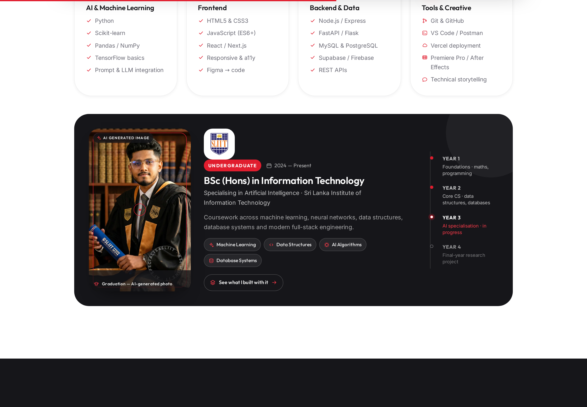
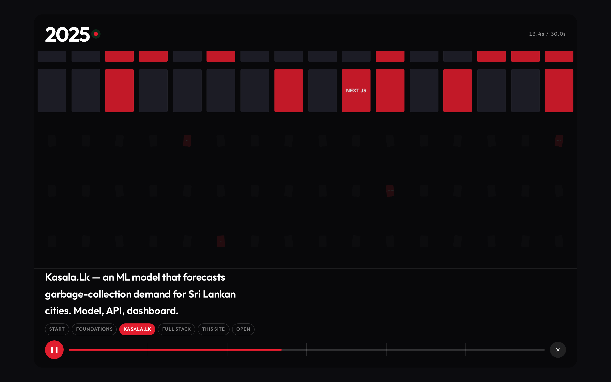
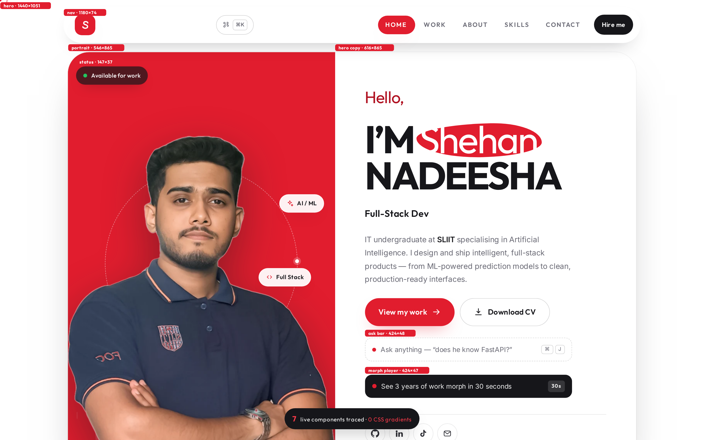
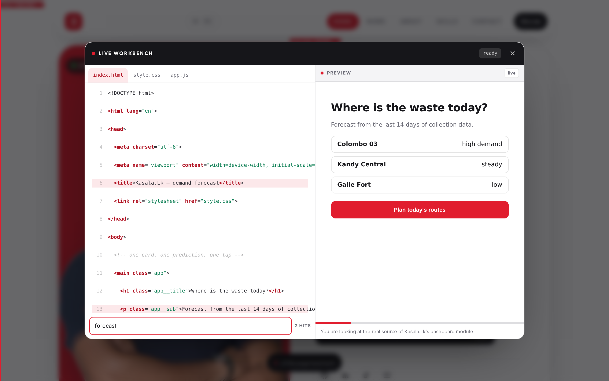
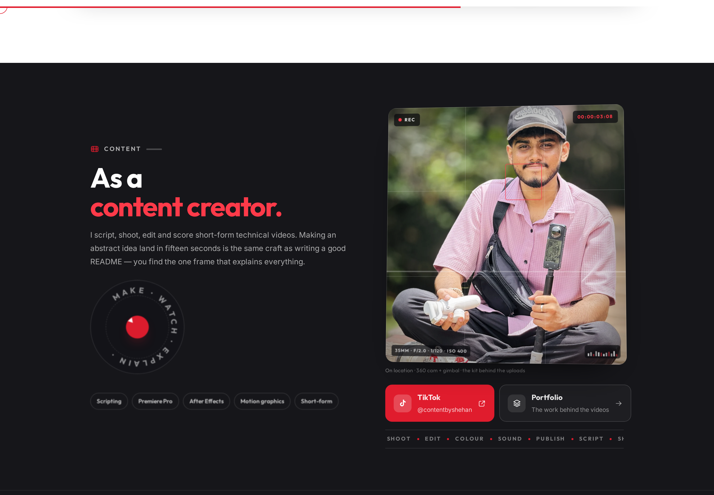
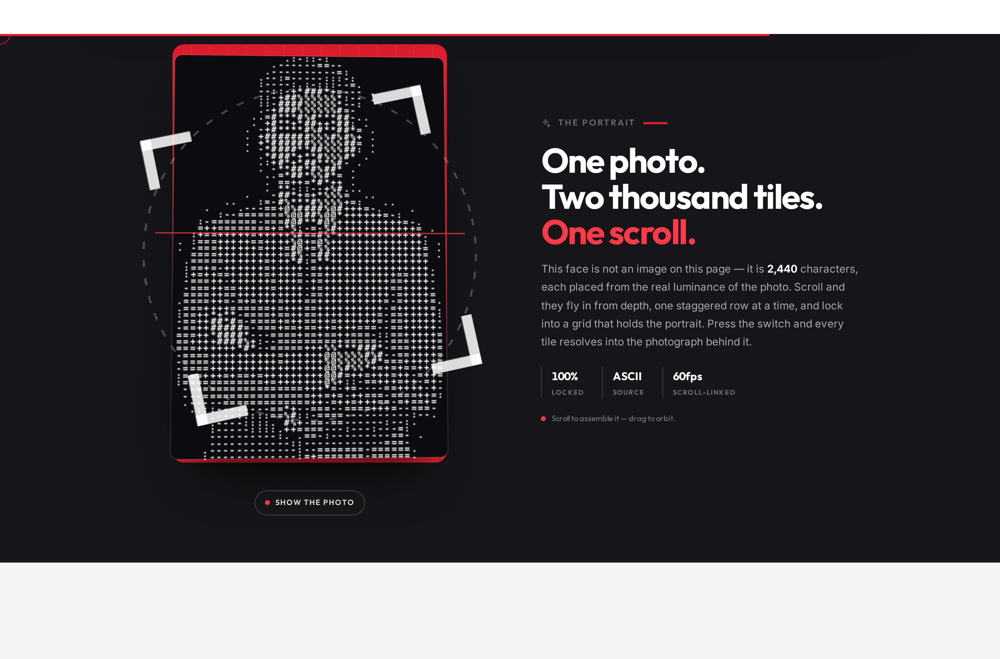
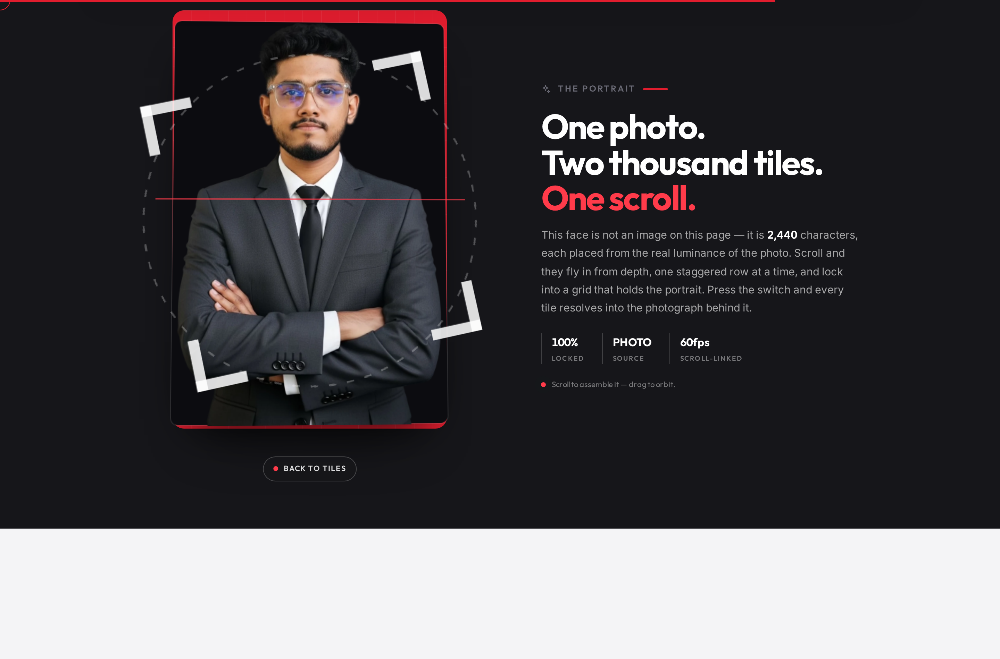
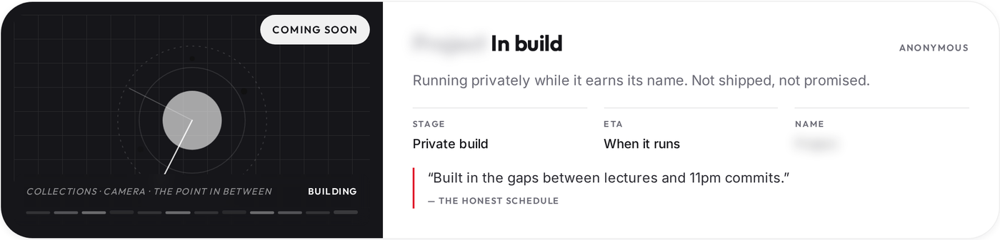
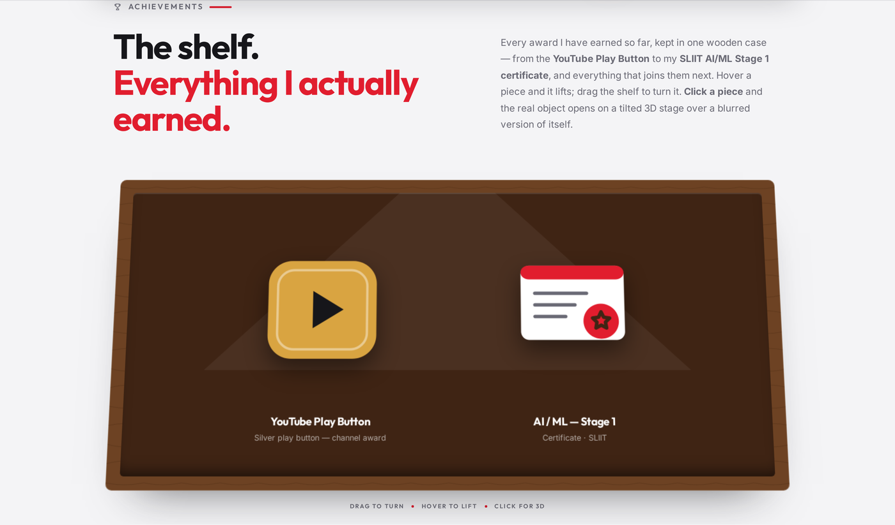
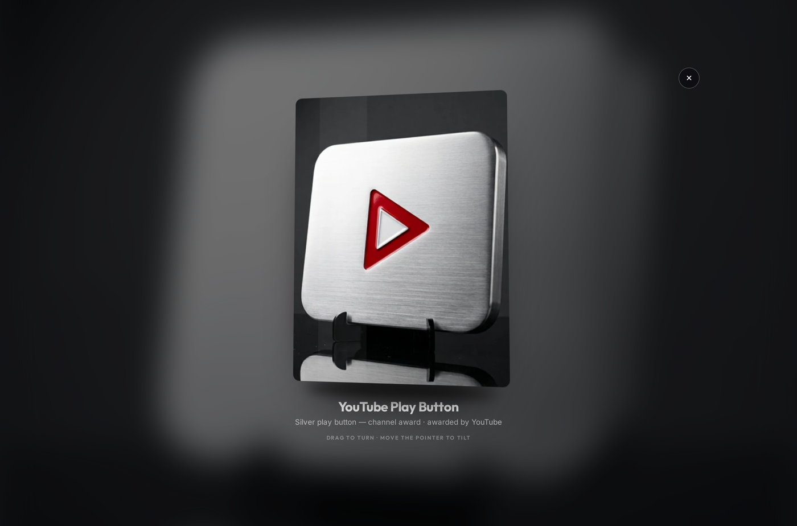
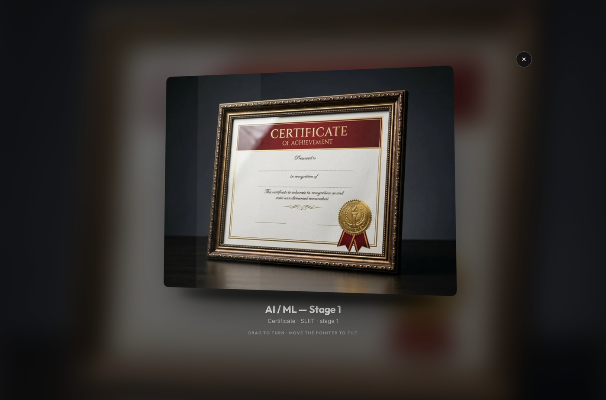

### Why it lands


- **Zero hallucination by construction** — the ask engine is a scored keyword/phrase
  matcher over a hand-written knowledge base; unmatched questions return an explicit
  “I don’t have that on the page” with the email address.
- **Honest scoring** — missing skills are shown, not hidden. The JD matcher distinguishes
  “my stack” from “learning”, so the number is defensible in an interview.
- **Instant demo** — opening the hero bar and clicking *Use a sample JD* takes
  three seconds and produces a 82 % match with a tailored pitch.
- **Works from `file://`** too — no build step, no dependencies.

## Advanced interaction features

1. **Command palette** — `⌘K` / `Ctrl+K` / `/` or the nav chip. Fuzzy filter, grouped commands (Navigate / Links / Commands), full keyboard control (`↑ ↓ ↵ esc`), 13 actions incl. "copy email" and "open terminal".
2. **Interactive terminal** — press `T`. A real shell-styled panel with command history (`↑`/`↓`) and commands: `whoami`, `skills`, `projects`, `kasala`, `contact`, `cv`, `ls`, `cat`, `clear`, `exit`, plus `sudo` / `rm` easter eggs.
3. **Torch reveal** — the about photo sits under a solid red veil reading "Build. Ship. Repeat."; moving the cursor cuts a circular hole (real `clip-path`, no gradient mask) that reveals a crisp copy of the photo lit under the pointer.
4. **Scroll-scrubbed statement** — a headline where each word lights up one-by-one as you scroll, with the "hot" word in brand red. Pure scroll-position driven, no timers.
5. **Cursor follower** — a lagging red ring + instant dot, which expands to a filled "VIEW" badge over project cards and grows on links. Disabled on touch and for reduced-motion users.
6. **Magnetic pull** — buttons, the nav logo and the palette chip lean toward the pointer.
7. **Spotlight cards** — a solid red dot + lit border tracks the pointer across stat, skill and project cards.
8. **3D tilt** — project cards tilt on a perspective plane with a deepened shadow on hover.
9. **Stencil wordmark + status ring** — a whisper-quiet "SHEHAN NADEESHA" sits behind the portrait, and the dashed ring around it carries a red/white orbiting dot.

All of the above are progressive enhancements: they no-op without a fine pointer,
and fully respect `prefers-reduced-motion`.

## Scroll-morph inventory

| Element | Morph driven by scroll |
|---|---|
| Hero card | corner radii shift, card scales + lifts slightly, red shadow deepens |
| Red portrait stage | inner corners re-shape, blob grows/drifts, dashed ring fades, portrait lifts |
| `I'm Shehan` highlight | blob spreads a little wider as the hero leaves |
| Nav logo tile | squircle → blob |
| Stat tiles / project cards / skill cards / education card / form | corners travel a few px squarer → rounder as each crosses the viewport (`--mp2`) — deliberately subtle on the wide stat tiles so they never deform |
| About photo frame + badge | same corner morph |
| Eyebrow rules | width grows with page progress |
| Section dividers | the wave path re-computes from scroll progress (live `d` morph) and the red edge line brightens |
| Progress bar | thin red bar at the very top of the page |

Hover morphs (pointer devices) are layered on top: button blob rise, card radius
spring, icon squircle→blob, magnetic button follow, nav morph-pill. Everything
respects `prefers-reduced-motion` (morphs freeze, reveals show instantly).

## Structure

```
portfolio/
├── index.html          # semantic single page + SVG sprite + Person JSON-LD
├── css/style.css       # tokens → components → scroll-morph engine → responsive
├── css/signature.css   # education, portrait tiles, achievement cabinet, award viewer, morph player,
        # trace, workbench, creator monitor, shortcuts overlay
├── js/main.js          # loader, scroll-morph driver, nav, reveals, counters, form, terminal
├── js/signature.js     # portrait tiles, cabinet, award viewer, morph player, trace overlay, workbench, nav keys
├── assets/
│   ├── hero-cutout.png/.webp   # transparent portrait (864 × 1100, background removed)
│   ├── about.webp / image5.jpg # Buildathon photo
│   ├── graduation.webp/.jpg    # convocation portrait (education block)
│   ├── Logo2.mp4 + poster      # Kasala.Lk preview (lazy loaded)
│   ├── uni.png / uni.webp      # SLIIT logo
│   ├── awards/*.webp           # the two studio renders the 3D viewer shows
│   ├── fonts/                  # Outfit + Inter (variable woff2, self-hosted)
│   ├── Shehan-Nadeesha-CV.pdf  # one-page A4 CV (red theme)
│   └── cv.html                 # CV source — edit + re-print any time
└── docs/                       # screenshots
```

## Sections

Hero → morph divider → dark marquee band → **stat strip** → Work (shipped +
coming-soon) → About → Skills + **Education (degree engraving)** →
**As a content creator** → **The portrait (ASCII tiles)** → Contact (validated form) →
morph divider → Footer.

## Keyboard shortcuts

| Key | Action |
|---|---|
| `⌘K` / `Ctrl+K` / `/` | Open the command palette |
| `?` | Shortcuts overlay |
| `G` then `W` `A` `S` `C` `E` `P` `B` | Go to work / about / skills / contact / creator / portrait / achievements |
| `F` | Resolve the portrait's ASCII tiles into the photograph |
| **`P`** | **Play the 30-second morph recap** |
| **`⇧T`** | **Toggle the trace overlay** |
| **`⇧W`** | **Open the live workbench** |
| `T` | Open the terminal |
| `↑` `↓` `↵` | Navigate / run inside palette |
| `Esc` | Close palette, shortcuts, terminal or mobile menu |
| `Tab` / `Shift+Tab` | Standard focus order (skip-link is first) |

## Run locally

```bash
cd portfolio
python3 -m http.server 8080
# open http://localhost:8080
```

## Deploy to GitHub Pages

1. Copy `index.html`, `css/`, `js/`, `assets/` into your `My-Portfolio` repo
   (keep `Projects/` — the Kasala.Lk case-study link points at it).
2. Commit + push to `main`.
3. Settings → Pages → Source: *Deploy from a branch* → `main` / `/ (root)`.
4. Live at `https://shehan-dev09.github.io/My-Portfolio/`.

## Before you publish

1. **Email** — replace `hello@shehannadeesha.dev` (hero socials, contact list,
   JSON-LD, `assets/cv.html`) with your real address.
2. **Coming-soon card** — there is exactly one unfinished card (`.pcard--live`),
   deliberately unnamed: the title is a blurred word, the art is a running loop.
   When it ships, give it a real title, description and tags, drop
   `.pcard--live`, and move it to a `.pcard--feature` card.
3. **CV** — regenerate from `assets/cv.html` (Chrome → Print → Save as PDF, A4,
   margins: none).
4. Contact form still uses your existing Web3Forms `access_key`; swap it if you
   rotate the key.

## Stat strip (redesigned)

The four highlights were rebuilt as a uniform metric row instead of floating tiles:

- fixed min-height and a shared baseline, so `3 / 12 / 15 / 100` line up across all cards
- icon tile top-left, small uppercase category label top-right
- one-line captions (uniform height), feature cards tinted red for a 1-2-1-2 rhythm
- hover = 4 px lift + red border + icon fill (no more percentage-radius "leaf" shape)
- scroll morph limited to 20→26 px corner radius
- 4-up on desktop, 2×2 on tablet and phone, 1-up under 400 px
- sits just under the dark band with no overlap; icons use the shared SVG sprite

## Performance / quality notes

- No third-party requests: fonts, icons and images are all same-origin.
- The scroll-morph engine is one `requestAnimationFrame` pass per scroll event
  and only writes two custom properties, so it stays smooth on mobile.
- Lazy video (`preload="none"`, IntersectionObserver, poster, respects Save-Data).
- Layout uses `clamp()` from 320 px to 2560 px; no horizontal scroll at
  360 / 390 / 768 / 1024 / 1440 / 1920 px.
- **Zero gradients** by design — checked programmatically against computed
  styles, so the theme stays flat and crisp.
- Everything is two deferred scripts. The portrait's tile field and the cabinet
  are rebuilt from data at runtime, and the workbench preview is fully inlined, so
  opening it makes **zero network requests**.
- The portrait is 2,440 characters positioned from the photo's own luminance —
  no image is drawn in the scene until you press `F`.
- Dialogs trap attention correctly: `Esc` closes, background scroll locks, and
  focus returns to whatever opened it.
- Screen-reader labels preserved for every icon-only control; skip link,
  focus-visible rings, Esc-closable menu, and reduced-motion support included.
